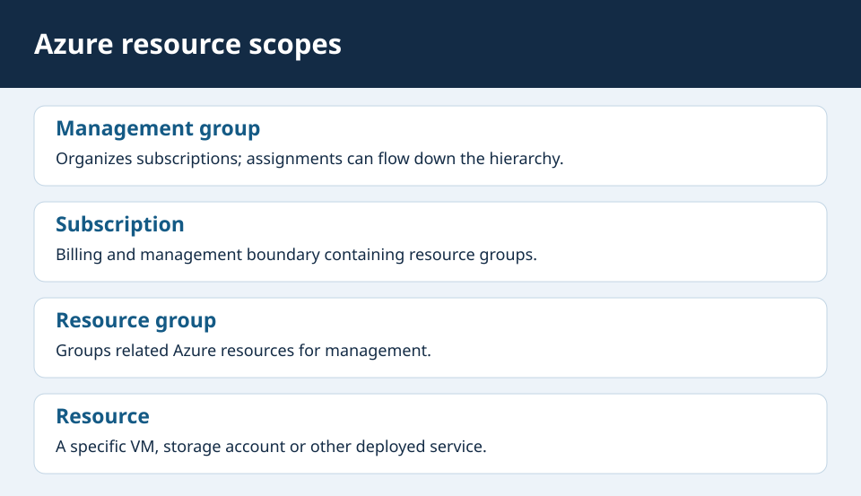
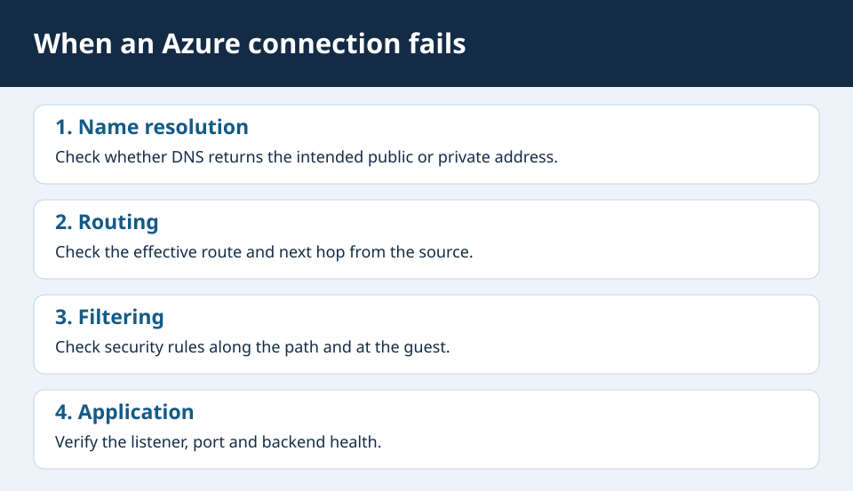
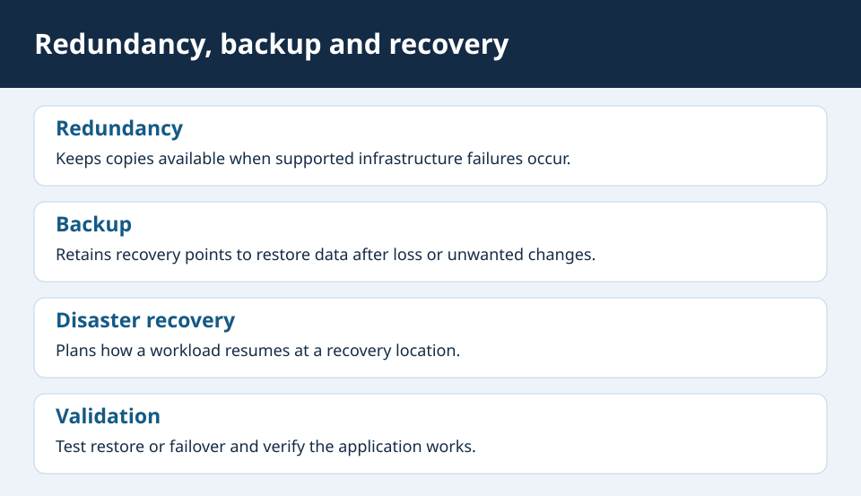

# AZ-104 — Illustrated Study Notes

[README](README.md) · [Source pages](SOURCE_PAGES.md)

This guide expands the supplied ASNETworkZONE AZ-104T00-A course outline. The PDF is a syllabus, not a full textbook or proof that any lab has been completed. The five sections below cover its listed skills in source order.

**Course goal.** An Azure administrator provisions, sizes, monitors and adjusts cloud resources. The outline connects subscription governance, identity security, infrastructure, virtual networks, hybrid connectivity and traffic management with storage, VMs, apps, containers, data sharing, backup and monitoring.

**Prerequisites.** Review on-premises virtualization (VMs, virtual networks, virtual disks); TCP/IP, DNS, VPNs, firewalls and encryption; AD users/groups and role-based access; and resilience, backup and restore. Your ESXi and Windows DNS labs give you familiar examples: compare a virtual switch/subnet to Azure networking concepts, and compare identity verification with permission checks. Entra ID is a cloud identity service; it is not simply your AD DS domain hosted in Azure.

**Exam weights below are printed in the supplied PDF.** Treat the outline as a course plan and compare its scope with the official Microsoft exam guide before booking the exam. Azure AD is called Microsoft Entra ID in these notes. Older or broader course topics are retained without claiming they remain on the exam.

## 1. Identity and governance — 15–20%

### Microsoft Entra ID objects

- **Users and groups:** Create user accounts and group related users for easier access management.

- **Licenses:** Assign product entitlements to eligible users; a license is not an Azure resource role.

- **Administrative units:** Scope selected directory administration to a subset of objects.

- **User and group properties:** Update profiles, membership and ownership as appropriate.

- **Device settings and identity:** Understand how device registration or join creates a directory identity and how settings control enrollment options.

- **Bulk updates:** Use batch operations for many objects; validate input on a small sample first.

- **Guest accounts:** Invite external identities and grant only the access they need.

- **Self-service password reset:** Enable eligible users to reset passwords using registered verification methods.

### Access control

- **Custom Azure RBAC and Entra roles:** Azure RBAC controls Azure resources; Entra roles control directory administration. Build custom roles only when built-in roles are insufficient.

- **Assignments at different scopes:** Assign a role to a principal at an appropriate management group, subscription, resource group or resource scope.

- **Interpret assignments:** Check principal, role, scope, inherited access and any relevant conditions.

### Subscriptions and governance

- **Azure Policy:** Evaluate or enforce resource rules, such as approved regions; policy does not grant user access.

- **Resource locks:** Use Delete or ReadOnly locks for management-plane protection; evaluate impact before applying.

- **Tags:** Add metadata such as Environment and CostCenter; tags do not automatically inherit from a resource group.

- **Resource groups:** Group resources for lifecycle management and scoped permissions.

- **Subscriptions:** Understand billing and management boundaries and subscription ownership.

- **Cost alerts, budgets and recommendations:** Compare spend to a budget and review recommendations; budget alerts alone do not stop charges.

- **Management groups:** Organize subscriptions for inherited policy and access assignments.

## 2. Storage — 15–20%

### Storage access

- **Network access:** Control which networks can reach storage; network reachability and authorization are separate checks.

- **Storage account creation:** Choose region, account options and redundancy according to workload needs.

- **Shared access signatures:** A SAS grants scoped, time-limited delegated access. Treat its URL or token as a secret.

- **Stored access policies:** Manage constraints and revocation for supported service SAS scenarios; not every SAS type supports them.

- **Access keys:** Account keys give broad access; prefer identity-based access where supported and plan rotation.

- **Entra authentication:** Use a supported identity flow and the correct data role; a management role alone does not necessarily grant data access.

- **Encryption:** Distinguish encryption at rest from encrypted transport and choose appropriate key management.

### Storage data operations

- **Import and export jobs:** Study the outline’s offline data-transfer workflow: plan source, destination, media and validation.

- **Storage Explorer and AzCopy:** Use a graphical tool for browsing and a command-line tool for repeatable transfers; verify results.

- **Redundancy:** Compare local, zone and geo redundancy by failure scope; redundancy is not backup.

- **Object replication:** Copy supported blobs asynchronously between accounts using replication rules.

### Azure Files and Blob Storage

- **Azure file share:** Create a managed file share for clients using a supported file protocol and access method.

- **Blob Storage:** Store objects in containers; distinguish object storage from a mounted file share.

- **Storage tiers:** Choose tiers according to access frequency, retrieval needs and charges.

- **Blob lifecycle:** Use rules to move or expire eligible blobs; test the rule scope before deletion.

## 3. Compute — 20–25%

### Templates and automation

- **Modify ARM template:** Parameterize values such as names and locations; validate dependencies.

- **Deploy template:** Preview changes, deploy to a selected scope and inspect deployment results.

- **Save or export template:** Use exported definitions as a starting point; check missing settings and secrets before reuse.

- **VM extensions:** Apply supported post-deployment configuration and inspect extension status.

### Virtual machines

- **Create VM:** Choose image, size, disks, subnet and secure administration method.

- **Azure Compute Gallery:** Organize reusable image definitions and versions for repeatable VM creation.

- **Azure Disk Encryption:** Recognize the source’s guest encryption topic; distinguish it from managed disk encryption at rest and check current Microsoft guidance before deploying.

- **Move VM between resource groups:** Validate move support and dependencies; a resource-group move is not a region migration.

- **VM sizing:** Match CPU, memory and performance needs; resizing may affect availability.

- **Data disks:** Attach a disk, then initialize and mount it in the guest as appropriate.

- **VM networking:** Understand NIC, subnet, IP configuration and security rules.

- **Availability options:** Compare availability zones and sets against the failure you need to tolerate.

- **VM scale sets:** Manage a group of VM instances and configure scaling around demand.

### Containers

- **ACI sizing and scaling:** Choose CPU and memory for a container group; distinguish sizing and adding groups from managed autoscaling.

- **ACI container groups:** Run cooperating containers in a group with shared lifecycle and networking context.

- **Azure Container Apps:** Deploy an app, configure ingress and understand revision and scaling settings.

- **AKS storage:** Distinguish persistent volumes and claims from temporary container storage.

- **AKS scaling:** Separate workload replica scaling from node pool scaling.

- **AKS networking:** Plan address ranges, service exposure and cluster connectivity.

- **AKS upgrades:** Check version compatibility, capacity and disruption before upgrading.

### App Service

- **App Service plan:** Choose the compute plan that hosts the app.

- **Plan scaling:** Distinguish scale up from scale out and review plan capabilities.

- **Create app:** Choose runtime and deploy to the selected plan.

- **Secure app:** Review HTTPS, authentication and access restrictions as appropriate.

- **Custom domains:** Validate ownership, configure DNS and associate a TLS certificate as appropriate.

- **App backup:** Plan coverage, retention and a tested restore for supported configurations.

- **App networking:** Distinguish inbound private access from outbound VNet integration.

- **Deployment settings:** Configure source, settings and supported slots; keep secrets out of repository files.

## 4. Networking — 20–25%

### Virtual networks

- **VNets and subnets:** Plan nonoverlapping address ranges and segment workloads.

- **Peering:** Connect compatible VNets; do not assume peering is transitive.

- **Private and public IPs:** Private addresses serve internal paths; public IP resources provide public addressing where needed.

- **User-defined routes:** Choose the next hop and confirm the effective route.

- **Azure DNS:** Manage relevant public or private zones and records; verify the intended resolver response.

### Secure access

- **NSGs and ASGs:** NSGs filter traffic; ASGs group VM network interfaces logically for rules.

- **Effective security rules:** Inspect combined subnet and NIC filtering when diagnosing reachability.

- **Bastion:** Connect to supported VM management ports without giving the target VM a public IP.

- **Service endpoints:** Extend subnet identity to supported services while keeping the service endpoint model.

- **Private endpoints:** Use a private IP for access to a supported service and verify private DNS resolution.

### Load balancing and troubleshooting

- **Application Gateway:** Use application-layer web routing and understand listeners, backend pools and health probes.

- **Internal and public Load Balancer:** Distribute transport-layer traffic using an internal or public frontend as needed.

- **Troubleshoot load balancing:** Check health probes, backend listeners, rules and security paths.

- **Monitor virtual networking:** Track network signals and compare against expected traffic patterns.

- **On-premises connectivity:** Check tunnel or connection status, routes and name resolution on both sides.

- **Azure Monitor for networks:** Use network monitoring views and available telemetry to investigate trends.

- **Network Watcher:** Use diagnostics such as connection troubleshooting and next-hop checks.

- **External network troubleshooting:** Start with DNS, public frontend, listener, routing and security rules.

- **VNet connectivity troubleshooting:** Check source, destination, DNS, effective routes and filtering before changing rules.

## 5. Monitoring and recovery — 10–15%

### Azure Monitor

- **Metrics:** Read numeric measurements over time; choose the right aggregation and time window.

- **Azure Monitor Logs:** Route or collect relevant events into a suitable workspace where supported.

- **Query and analyze logs:** Use KQL to filter, group and correlate events with the incident time.

- **Alerts and actions:** Use a signal and condition to trigger a notification or action group.

- **VM, storage and network monitoring:** VM insights focuses on VMs; use the matching storage and network monitoring views for those resources.

### Backup and disaster recovery

- **Recovery Services vault:** Identify supported workloads and their backup or recovery configuration.

- **Backup vault:** Use the vault type supported by the workload; do not assume vaults are interchangeable.

- **Backup policy:** Define frequency and retention according to recovery requirements.

- **Backup and restore:** Validate a recovery point by restoring into a safe target and checking recovered data.

- **Azure Site Recovery configuration:** Plan replication, dependencies and recovery targets for supported workloads.

- **Secondary-region failover:** Understand test failover, validation and recovery order before a real failover.

- **Backup reports:** Review coverage, job success, failures and recovery readiness.

## Planned practice and evidence

These are proposed exercises. Check subscription permissions and costs before deploying, and remove disposable lab resources after collecting evidence.

1. Assign Reader to a test group at a lab resource group; record the allowed scope.

2. Upload a sample blob, test identity access, and compare it with a tightly scoped SAS.

3. Plan a small VM and disk deployment; record the selected size, image and network.

4. Draw two subnets and predict DNS, route, security and listener behavior before testing.

5. Pick a monitoring signal and write a restore validation checklist.

## Revision questions

**1. Does a license grant access to an Azure VM?**  
No. Product entitlement and Azure RBAC are separate.

**2. What are the three parts of a role assignment?**  
Principal, role and scope.

**3. Can a budget alert stop spending?**  
Not by itself; it signals that a threshold was reached.

**4. Why use a short-lived SAS?**  
To delegate limited access and reduce exposure if the token leaks.

**5. Does redundancy replace backup?**  
No. Backup provides recovery points for unwanted changes or loss.

**6. What is scale out?**  
Adding instances rather than increasing one instance’s capacity.

**7. Does VNet peering imply transitive access?**  
No. Plan and verify each required path.

**8. Why can a private endpoint fail even with correct permissions?**  
DNS or routing may send traffic to the wrong destination.

**9. When choose Application Gateway over Load Balancer?**  
When web-layer routing such as host or path routing is needed.

**10. What is the difference between a metric and a log?**  
A metric is a numeric time series; a log is a record with event details.

**11. What is the difference between restore and failover?**  
Restore retrieves data or a workload from a recovery point; failover shifts service to a recovery target.

**12. Why test a recovery plan?**  
Successful replication or backup jobs do not prove the recovered application works.

## References

- [Microsoft AZ-104 study guide](https://learn.microsoft.com/en-us/credentials/certifications/resources/study-guides/az-104)
- [Microsoft Azure documentation](https://learn.microsoft.com/en-us/azure/)
- [Supplied course outline — rendered pages](SOURCE_PAGES.md)
