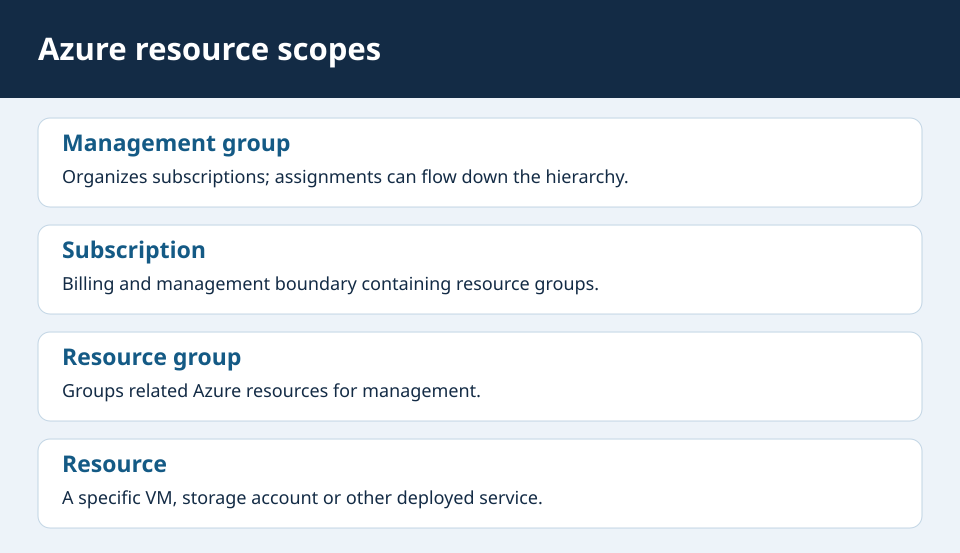
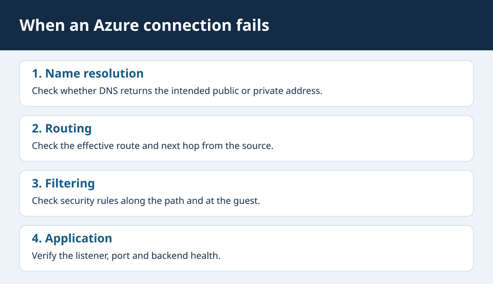
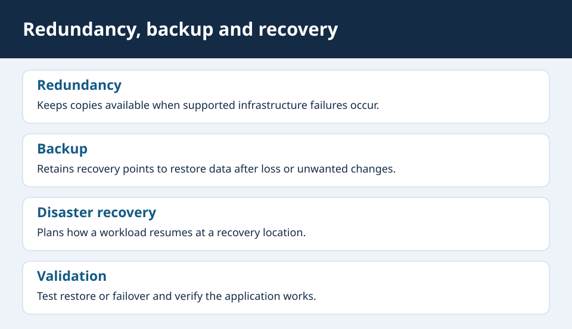

# AZ-104 — Tasveeron ke Saath Study Notes

[README](README.md) · [Source pages](SOURCE_PAGES.md)

Yeh guide di hui ASNETworkZONE AZ-104T00-A course outline ko tafseel se samjhati hai. PDF syllabus hai, poori textbook ya lab completion ka saboot nahin. Neeche paanch sections mein listed skills source ki tarteeb mein hain.

**Course ka maqsad.** Azure administrator cloud resources provision, size, monitor aur adjust karta hai. Outline subscription governance, identity security, infrastructure, virtual networks, hybrid connectivity aur traffic management ko storage, VMs, apps, containers, data sharing, backup aur monitoring se jorti hai.

**Pehle kya aana chahiye?** On-premises virtualization (VMs, virtual networking aur virtual disks), TCP/IP, DNS, VPNs, firewalls aur encryption, AD users/groups aur role-based access, aur resilience, backup aur restore revise karein. ESXi aur Windows DNS labs se misaal lein: virtual switch/subnet ko Azure networking se compare karein aur identity verification ko permission check se alag samjhein. Entra ID cloud identity service hai; yeh sirf Azure par hosted aap ka AD DS domain nahin.

**Neeche exam weights di hui PDF se hain.** Outline ko course plan samjhein aur exam book karne se pehle official Microsoft exam guide se scope compare karein. Azure AD ko notes mein Microsoft Entra ID kaha gaya hai. Puranay ya broader course topics rakhe gaye hain; inhen current exam scope ki tasdeeq na samjhein.

## 1. Identity aur governance — 15–20%

### Microsoft Entra ID ke objects

- **Users and groups:** User accounts banayein aur access manage karne ke liye users ko groups mein rakhein.

- **Licenses:** Eligible users ko product license dein; license Azure resource role nahin hota.

- **Administrative units:** Directory administration ko chuninda objects tak mehdood karein.

- **User and group properties:** Profiles, membership aur ownership zaroorat ke mutabiq update karein.

- **Device settings and identity:** Samjhein ke device registration ya join se directory identity kaise banti hai aur settings enrollment ko kaise control karti hain.

- **Bulk updates:** Bohat se objects ke liye batch operations use karein; pehle chhota sample verify karein.

- **Guest accounts:** External identities invite karein aur sirf zaroori access dein.

- **Self-service password reset:** Eligible users ko registered verification methods se password reset karne dein.

### Access control

- **Custom Azure RBAC and Entra roles:** Azure RBAC resources ka access control karta hai; Entra roles directory administration ka. Custom role tab banayein jab built-in role kaafi na ho.

- **Assignments at different scopes:** Principal ko munasib management group, subscription, resource group ya resource scope par role dein.

- **Interpret assignments:** Principal, role, scope, inherited access aur relevant conditions check karein.

### Subscriptions aur governance

- **Azure Policy:** Resource rules evaluate ya enforce karein, jaise approved regions; policy user access nahin deti.

- **Resource locks:** Management-plane protection ke liye Delete ya ReadOnly lock lagayein; pehle asar dekhein.

- **Tags:** Environment aur CostCenter jaisi metadata lagayein; resource group ke tags khud-ba-khud inherit nahin hote.

- **Resource groups:** Lifecycle aur scoped permissions ke liye resources group karein.

- **Subscriptions:** Billing aur management boundaries aur subscription ownership samjhein.

- **Cost alerts, budgets and recommendations:** Kharch budget se compare karein aur recommendations dekhein; budget alert akela charges nahin rokta.

- **Management groups:** Subscriptions organize karein taa ke policy aur access assignments inherit ho sakein.

## 2. Storage — 15–20%

### Storage access

- **Network access:** Control karein kaun se networks storage tak pohanch sakte hain; network aur authorization alag checks hain.

- **Storage account creation:** Workload ki zaroorat ke mutabiq region, account options aur redundancy choose karein.

- **Shared access signatures:** SAS mehdood scope aur waqt ke liye delegated access deta hai. URL ya token ko secret rakhein.

- **Stored access policies:** Supported service SAS ke constraints aur revocation manage karein; har SAS type mein yeh facility nahin hoti.

- **Access keys:** Account keys broad access deti hain; jahan mumkin ho identity-based access use karein aur rotation plan karein.

- **Entra authentication:** Supported identity flow aur sahi data role use karein; management role akela lazman data access nahin deta.

- **Encryption:** Encryption at rest aur encrypted transport ka farq samjhein aur key management choose karein.

### Storage data operations

- **Import and export jobs:** Outline ke offline data-transfer workflow mein source, destination, media aur verification plan karein.

- **Storage Explorer and AzCopy:** Browsing ke liye GUI aur repeatable transfers ke liye CLI use karein; results verify karein.

- **Redundancy:** Local, zone aur geo redundancy ko failure scope se compare karein; redundancy backup nahin.

- **Object replication:** Replication rules se supported blobs accounts ke darmiyan asynchronously copy karein.

### Azure Files aur Blob Storage

- **Azure file share:** Supported file protocol aur access method se managed file share banayein.

- **Blob Storage:** Objects containers mein store karein; object storage aur mounted file share ka farq samjhein.

- **Storage tiers:** Access frequency, retrieval aur charges ke mutabiq tier choose karein.

- **Blob lifecycle:** Rules se eligible blobs move ya expire karein; deletion se pehle scope test karein.

## 3. Compute — 20–25%

### Templates aur automation

- **Modify ARM template:** Naam aur location jaisi values parameterize karein aur dependencies validate karein.

- **Deploy template:** Changes preview karein, selected scope par deploy karein aur result dekhein.

- **Save or export template:** Exported definition ko starting point samjhein; reuse se pehle missing settings aur secrets check karein.

- **VM extensions:** Supported post-deployment configuration lagayein aur extension status check karein.

### Virtual machines

- **Create VM:** Image, size, disks, subnet aur secure administration method choose karein.

- **Azure Compute Gallery:** Repeatable VM creation ke liye image definitions aur versions organize karein.

- **Azure Disk Encryption:** Source ka guest encryption topic samjhein; managed disk encryption at rest se farq rakhein aur deployment se pehle current guidance check karein.

- **Move VM between resource groups:** Move support aur dependencies validate karein; resource-group move region migration nahin.

- **VM sizing:** CPU, memory aur performance needs match karein; resize availability par asar daal sakta hai.

- **Data disks:** Disk attach karein, phir guest mein munasib initialization aur mount karein.

- **VM networking:** NIC, subnet, IP configuration aur security rules samjhein.

- **Availability options:** Jis failure ko tolerate karna hai us ke mutabiq zones aur sets compare karein.

- **VM scale sets:** VM instances ka group manage karein aur demand ke mutabiq scaling configure karein.

### Containers

- **ACI sizing and scaling:** Container group ke CPU/RAM choose karein; sizing aur groups barhana managed autoscaling se alag hai.

- **ACI container groups:** Cooperating containers ko shared lifecycle aur networking context wale group mein chalayein.

- **Azure Container Apps:** App deploy karein, ingress configure karein aur revisions/scaling samjhein.

- **AKS storage:** Persistent volumes aur claims ko temporary container storage se alag samjhein.

- **AKS scaling:** Workload replicas aur node pool scaling ko alag samjhein.

- **AKS networking:** Address ranges, service exposure aur cluster connectivity plan karein.

- **AKS upgrades:** Upgrade se pehle version compatibility, capacity aur disruption check karein.

### App Service

- **App Service plan:** App host karne wala compute plan choose karein.

- **Plan scaling:** Scale up aur scale out ka farq samjhein aur plan capabilities dekhein.

- **Create app:** Runtime choose karein aur selected plan par app deploy karein.

- **Secure app:** Zaroorat ke mutabiq HTTPS, authentication aur access restrictions review karein.

- **Custom domains:** Ownership verify karein, DNS configure karein aur zaroorat par TLS certificate link karein.

- **App backup:** Supported configurations ke liye backup coverage, retention aur restore test plan karein.

- **App networking:** Inbound private access aur outbound VNet integration ka farq samjhein.

- **Deployment settings:** Source, settings aur supported slots configure karein; secrets repo files mein na rakhein.

## 4. Networking — 20–25%

### Virtual networks

- **VNets and subnets:** Nonoverlapping ranges plan karein aur workloads ko subnets mein divide karein.

- **Peering:** Compatible VNets connect karein; peering ko transitive na samjhein.

- **Private and public IPs:** Private IP internal path ke liye; public IP jahan public addressing darkar ho.

- **User-defined routes:** Next hop choose karein aur effective route verify karein.

- **Azure DNS:** Public ya private zones aur records manage karein aur intended resolver ka jawab verify karein.

### Secure access

- **NSGs and ASGs:** NSGs traffic filter karte hain; ASGs rules ke liye VM interfaces ko logically group karte hain.

- **Effective security rules:** Reachability troubleshoot karte waqt subnet aur NIC ki combined filtering check karein.

- **Bastion:** Target VM ko public IP diye baghair supported management ports tak connect karein.

- **Service endpoints:** Supported services ke liye subnet identity use karein; yeh private IP endpoint nahin banata.

- **Private endpoints:** Supported service ke access ke liye private IP use karein aur private DNS resolution verify karein.

### Load balancing aur troubleshooting

- **Application Gateway:** Web application-layer routing mein listeners, backend pools aur health probes samjhein.

- **Internal and public Load Balancer:** Zaroorat ke mutabiq internal ya public frontend se transport-layer traffic distribute karein.

- **Troubleshoot load balancing:** Health probes, backend listeners, rules aur security paths check karein.

- **Monitor virtual networking:** Network signals ko expected traffic patterns se compare karein.

- **On-premises connectivity:** Tunnel ya connection status, routes aur DNS dono sides par check karein.

- **Azure Monitor for networks:** Network monitoring views aur telemetry se trends investigate karein.

- **Network Watcher:** Connection troubleshooting aur next-hop checks jaise diagnostics use karein.

- **External network troubleshooting:** DNS, public frontend, listener, routing aur security rules se shuru karein.

- **VNet connectivity troubleshooting:** Rules badalne se pehle source, destination, DNS, effective routes aur filtering check karein.

## 5. Monitoring aur recovery — 10–15%

### Azure Monitor

- **Metrics:** Waqt ke saath numeric measurements dekhein; sahi aggregation aur time window choose karein.

- **Azure Monitor Logs:** Relevant events ko supported tareeqay se munasib workspace mein collect ya route karein.

- **Query and analyze logs:** KQL se events filter, group aur incident ke waqt ke saath correlate karein.

- **Alerts and actions:** Signal aur condition se notification ya action group trigger karein.

- **VM, storage and network monitoring:** VM insights VMs par focus karta hai; storage aur network ke liye un ke munasib monitoring views use karein.

### Backup aur disaster recovery

- **Recovery Services vault:** Supported workloads aur un ki backup/recovery configuration pehchanein.

- **Backup vault:** Workload ke liye supported vault type use karein; dono vault types ek jaisay nahin.

- **Backup policy:** Recovery requirements ke mutabiq frequency aur retention define karein.

- **Backup and restore:** Safe target mein restore karke recovery point aur recovered data verify karein.

- **Azure Site Recovery configuration:** Supported workloads ke liye replication, dependencies aur recovery targets plan karein.

- **Secondary-region failover:** Asal failover se pehle test failover, verification aur recovery order samjhein.

- **Backup reports:** Coverage, successful jobs, failures aur recovery readiness review karein.

## Planned practice aur evidence

Yeh planned exercises hain. Deploy karne se pehle subscription permissions aur costs check karein; evidence lene ke baad disposable lab resources remove karein.

1. Test group ko lab resource group par Reader dein; allowed scope record karein.

2. Sample blob upload karein, identity access test karein aur mehdood SAS se compare karein.

3. Chhoti VM aur disk deployment plan karein; size, image aur network record karein.

4. Do subnets draw karein aur test se pehle DNS, route, security aur listener behavior predict karein.

5. Monitoring signal choose karein aur restore validation checklist likhein.

## Revision sawalat

**1. Kya license Azure VM ka access deta hai?**  
Nahin. Product entitlement aur Azure RBAC alag hain.

**2. Role assignment ke teen hissay?**  
Principal, role aur scope.

**3. Kya budget alert kharch rokta hai?**  
Akela nahin; yeh threshold ka signal deta hai.

**4. Short-lived SAS kyun?**  
Mehdood access dene aur leak ka asar kam karne ke liye.

**5. Kya redundancy backup ka badal hai?**  
Nahin. Backup se purana recovery point restore ho sakta hai.

**6. Scale out kya hai?**  
Ek instance ko bara karne ke bajaye instances barhana.

**7. Kya VNet peering transitive hai?**  
Khud-ba-khud nahin. Har required path plan aur verify karein.

**8. Sahi permission ke bawajood private endpoint kyun fail ho sakta hai?**  
DNS ya routing traffic ko ghalat destination bhej sakti hai.

**9. Application Gateway kab choose karein?**  
Jab web-layer host ya path routing chahiye.

**10. Metric aur log mein farq?**  
Metric waqt ke saath numeric value hai; log event ki tafseel rakhta hai.

**11. Restore aur failover mein farq?**  
Restore recovery point se data ya workload wapas lata hai; failover service recovery target par shift karta hai.

**12. Recovery plan test kyun karein?**  
Successful replication ya backup job se application ka recovery ke baad chalna sabit nahin hota.

## Hawalay

- [Microsoft AZ-104 study guide](https://learn.microsoft.com/en-us/credentials/certifications/resources/study-guides/az-104)
- [Microsoft Azure documentation](https://learn.microsoft.com/en-us/azure/)
- [Supplied course outline — rendered pages](SOURCE_PAGES.md)
